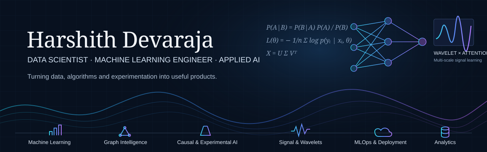

<div align="center">



</div>

<div align="center">

# Harshith Devaraja

### Data Scientist · Statistical Modelling · Decision Science

**Using statistics, experimentation and machine learning to support better decisions.**

<p>
  <a href="https://harshithpatali.github.io/harshith-portfolio/">Portfolio</a> ·
  <a href="https://www.linkedin.com/in/harshith-devaraja-087ba0228">LinkedIn</a> ·
  <a href="mailto:harshikollur302@gmail.com">Email</a> ·
  <a href="https://github.com/Harshithpatali">GitHub</a>
</p>

<a href="https://github.com/Harshithpatali">
  
</a>

</div>

---

## About

I'm an M.Sc. Applied Mathematics & Computing graduate focused on **data science, statistical inference, experimentation and customer analytics**. I use Python and SQL to frame analytical questions, establish baselines, validate models and translate results into decision-ready evidence.

I enjoy the full process: framing a question, understanding the data, establishing a baseline, validating a model, interpreting the result, and delivering something people can actually use.

My strongest areas of work are **statistical analysis, causal inference, customer intelligence, time-series forecasting and predictive modelling**. I also maintain selected applied-AI and signal-processing projects as supporting technical interests.

## What I work on

<table>
<tr>
<td width="33%" valign="top">

**Statistics & decision science**

- Statistical inference and hypothesis testing
- A/B testing and experimental design
- Causal inference and uplift modelling
- Cohort and survival analysis
- SQL analytics and customer metrics

</td>
<td width="33%" valign="top">

**Machine learning**

- Predictive modeling
- Graph learning and anomaly detection
- Time-series forecasting
- Feature engineering
- Model explainability and evaluation

</td>
<td width="33%" valign="top">

**Analytics & delivery**

- Python analytics and visualization
- Reproducible modelling workflows
- FastAPI and Streamlit applications
- MLflow and model evaluation
- Docker and CI/CD

</td>
</tr>
</table>

## Technology stack

The tools I use across analytics, modeling, AI development, and deployment.

<div align="center">

**Languages & data**


**Machine learning & scientific computing**


**Web, APIs & visualization**


**Engineering & cloud**


</div>

<p align="center">
  
  
  
  
  
  
  
  
  
  
</p>

---

## Featured projects

Four flagship projects across statistical decision science, customer analytics, causal modelling and forecasting. Each README documents methodology, evaluation evidence and limitations.

### 01 · Causal Uplift Modelling for Email Marketing

**Randomized experiment → heterogeneous treatment effects → targeting policy evaluation**

[](https://github.com/Harshithpatali/causal-uplift-marketing-optimization)

- 64,000-customer Hillstrom randomized email experiment.
- ATE analysis and T-Learner / class-transformation uplift models.
- Held-out Qini, AUUC and uplift-at-depth evaluation.
- Best reported AUUC 0.002054 and Qini 0.004129.

**Stack:** Python · Pandas · LightGBM · Causal inference · Statistical evaluation

<sub>Policy estimates are evaluation-sample results, not guaranteed future campaign outcomes; the dataset does not include campaign costs for net-profit measurement.</sub>

### 02 · Customer Intelligence & Graph Anomaly Research

**Customer behaviour, segmentation, anomaly investigation, and entity networks**

[](https://github.com/Harshithpatali/Graph-anomaly-supervised-neural-prediction) [](https://graph-anomaly-supervised-neural-prediction-v1.streamlit.app/)

- Customer-level behavioural profiles and unsupervised segmentation.
- Isolation Forest and Local Outlier Factor anomaly ranking.
- User–device–IP graph exploration, connectivity measures, and communities.
- Customer 360 investigation with supporting behavioural evidence.

**Stack:** Python · Pandas · scikit-learn · NetworkX · Plotly · Streamlit

<sub>Research note: behavioural-risk scores are cohort-relative heuristics, not calibrated fraud probabilities. Anomaly rankings are investigation aids, not proof of wrongdoing.</sub>

### 03 · Brazilian E-Commerce Intelligence

**SQL-first marketplace analytics and customer decision science**

[](https://github.com/Harshithpatali/brazilian-ecommerce-data-science) [](https://olist-ecommerce-ds.streamlit.app/)

- Relational data modeling and analytical SQL transformations.
- RFM segmentation, customer value, cohorts, and retention analysis.
- Kaplan–Meier time-to-second-purchase analysis with right-censoring.
- Point-in-time churn research and baseline comparisons.
- Campaign scenario simulator linking assumptions to contribution economics.

**Stack:** Python · PostgreSQL · SQL · scikit-learn · MLflow · Streamlit

<sub>Model transparency: the documented current churn model did not outperform the lifetime-frequency baseline on the untouched holdout. The repository reports this limitation rather than overstating predictive performance.</sub>

### 04 · Retail Demand Forecasting & Inventory Optimization

**Forecasting connected to inventory cost and service-level decisions**

[](https://github.com/Harshithpatali/retail-demand-inventory-optimization) [](https://retail-demand-inventory-optimization-v1.streamlit.app/) [](https://retail-demand-inventory-optimization.onrender.com/)

- Naive, seasonal-naive, and moving-average baselines compared with XGBoost and LightGBM.
- Chronological validation and out-of-sample uncertainty estimation.
- Periodic-review inventory policy and simulation.
- Business evaluation through holding, ordering, and stockout costs.

**Documented validation result:** XGBoost WAPE 0.2808 versus 0.6873 for the naive baseline on the 200-series modeling subset.

**Stack:** Python · Pandas · XGBoost · LightGBM · FastAPI · Streamlit

### 05 · Bayesian Sequential Experimentation

**Sequential evidence and Bayesian experiment analysis**

[](https://github.com/Harshithpatali/bayesian-sequential-experimentation)

Exploring Bayesian experimentation, sequential decision-making, and how uncertainty changes as observations accumulate.

### 06 · LLM Reliability & Evaluation Platform

**Evaluation telemetry, asynchronous processing, and statistical drift monitoring**

[](https://github.com/Harshithpatali/llm-evaluation-platform) [](https://llm-evaluation-platform-q.streamlit.app/) [](https://llm-evaluation-platform-1.onrender.com/docs)

- Asynchronous evaluation with FastAPI, Celery, and Redis.
- Distribution monitoring using Kolmogorov–Smirnov tests and Wasserstein distance.
- Evaluation history, latency, and reliability dashboards.

**Stack:** Python · FastAPI · Celery · Redis · SciPy · Streamlit

### 07 · Enterprise ML Platform

**Distributed data processing through model serving**

[](https://github.com/Harshithpatali/enterprise-ml-platform) [](https://enterprise-ml-platform.onrender.com)

- Hadoop HDFS and PySpark medallion-style data processing.
- Temporal customer features and leakage-aware target construction.
- XGBoost model serving and SHAP explanations.
- FastAPI service and Streamlit dashboard.

**Stack:** Python · Hadoop · PySpark · XGBoost · SHAP · FastAPI · Docker

### 08 · Wavelet & Signal Intelligence

**Signal processing, mathematical representations, and machine learning**

[Wavelet experiments](https://github.com/Harshithpatali/Wavelets) · [ECG project](https://github.com/Harshithpatali/Haar_ECG) · [Wavelet/deepfake research](https://github.com/Harshithpatali/deepfake-noise-wavelet-ml)

Exploring wavelet representations, signal analysis, and medical-signal classification. A research direction I am particularly interested in is **wavelet-based attention for Transformers**: investigating whether multi-scale frequency and time-frequency representations can provide useful inductive bias for attention mechanisms.

---

## My approach

<div align="center">

```text
   FRAME THE PROBLEM
          ↓
   UNDERSTAND THE DATA
          ↓
   EXPLORE & ESTABLISH BASELINES
          ↓
   MODEL & VALIDATE
          ↓
   INTERPRET THE EVIDENCE
          ↓
   DEPLOY & MONITOR
```

</div>

I value appropriate validation design, reproducibility, strong baselines, clear assumptions, and honest reporting. A useful model is not simply one with a high score — it is one whose performance and limitations are understood.

## Education

**M.Sc. Applied Mathematics & Computing**  
Manipal Academy of Higher Education

**Selected certifications & learning**

- IBM Machine Learning
- IBM Data Science Professional Certificate
- IBM Generative AI Engineering
- Machine Learning — University of Michigan
- Deep Learning Specialization

## Let's connect

I'm open to **Data Scientist, Decision Science, Experimentation Analyst and Customer Analytics** opportunities, especially roles where statistical reasoning and machine learning support real business decisions.

<p align="center">
  <a href="https://www.linkedin.com/in/harshith-devaraja-087ba0228"></a>
  <a href="https://harshith-portfolio.vercel.app/"></a>
  <a href="mailto:harshikollur302@gmail.com"></a>
</p>

<div align="center">

*Build carefully · Evaluate honestly · Make the result useful*

</div>
